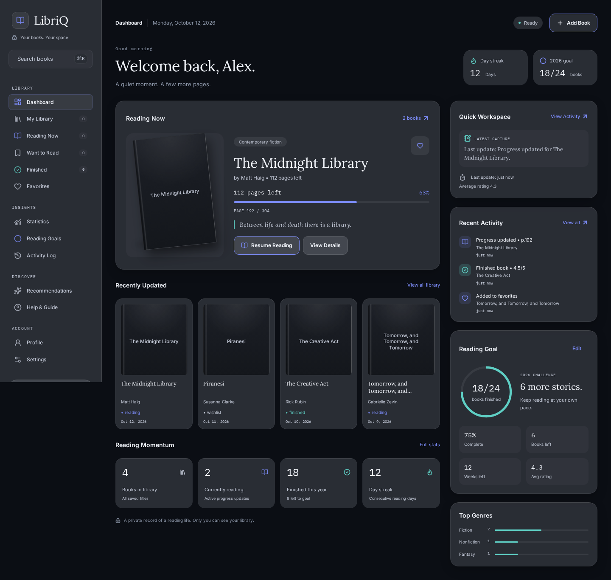
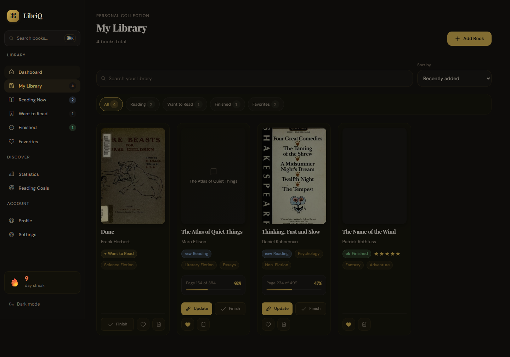
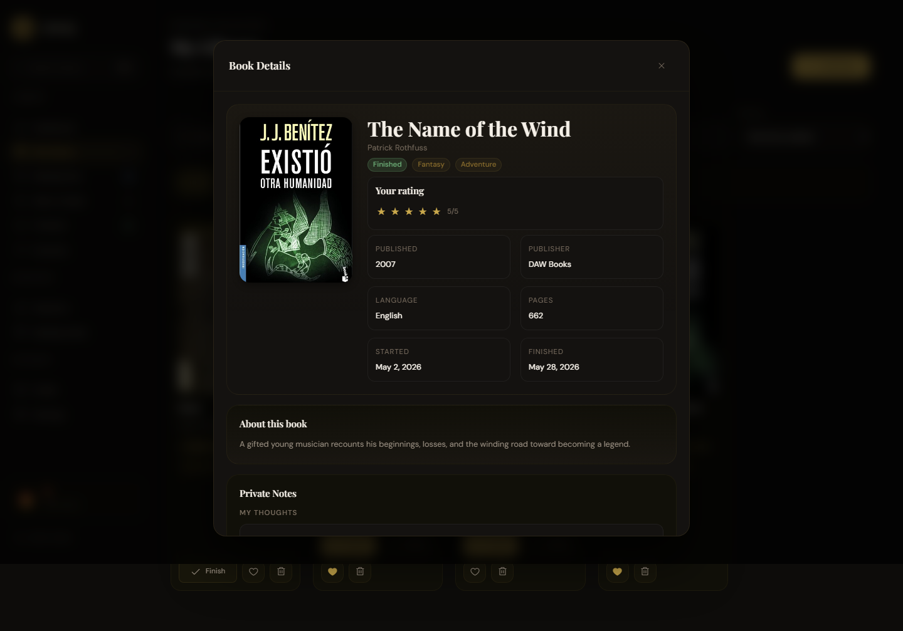
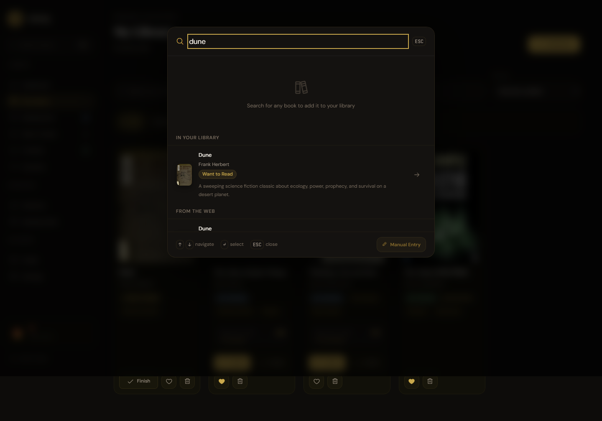

<div align="center">


# LibriQ

**A calm, privacy-first personal library & reading tracker.**

[](LICENSE)
[](tests/)
[](frontend/manifest.json)
[](https://libriq.app)

*No social algorithms, zero ads, no clutter. Just your books, your reading streaks, and your private notes.*

[Live Demo](https://libriq.app) · [User Guide](docs/USER_GUIDE.md) · [Architecture](docs/ARCHITECTURE.md) · [Changelog](docs/CHANGELOG.md)

</div>

---

## 🌟 Overview

**LibriQ** is an aesthetic, local-first web app designed for readers who want to track their personal library without the bloat of traditional reading platforms. It combines Google Books and Open Library metadata deduplication, offline PWA reliability, and optional Firestore cloud sync into a unified, glass-styled workspace.

---

## ✨ Key Features

- **🔎 Multi-Engine Book Search & Auto-Enrichment**: Merged, deduplicated results across **Google Books** and **Open Library**, with automated background description resolution via **Wikipedia REST API** and Open Library Works fallback. Includes readable **Internet Archive** links and free classics from **Gutendex**.
- **📖 Cover-Forward Library & 3D Bookshelf**: Filter and sort books by reading status (*Reading*, *Wishlist*, *Finished*, *Did Not Finish*), custom shelves, favorites, or realistic 3D cedar bookshelf spine views.
- **📊 Reading Insights & Streaks**: Track annual goals, pages read, daily reading streaks, completion percentages, and detailed yearly summaries.
- **📝 Private Notes & Quotes**: Save custom annotations, favorite excerpts, and personal star ratings directly on each book card.
- **🛡️ Data Ownership & Resilience**:
  - Full **offline PWA** functionality via service workers and `localStorage`.
  - Self-hosted local icon system (Phosphor) with zero external CDN dependencies.
  - Export and restore complete **JSON library backups**.
  - Optional **Cloud Firestore sync** with real-time sync health diagnostics and safe async confirmation dialogs.
- **🎨 Glassmorphic Interface**: Fully responsive, editorial glass design across both dark and light palettes.

---

## 📸 App Preview

| Dashboard | Library Shelf |
| :---: | :---: |
|  |  |

| Book Details & Notes | Search & Discovery |
| :---: | :---: |
|  |  |

---

## 🛠️ Tech Stack

- **Frontend**: Vanilla JavaScript (Native ES Modules), HTML5, CSS3 (Modern Glassmorphism Design System)
- **APIs & Discovery**: Google Books API, Open Library API, Wikipedia REST API, Gutendex (Project Gutenberg), Internet Archive
- **Offline & Storage**: PWA Service Worker, Web App Manifest, `localStorage`
- **Cloud & Auth (Optional)**: Firebase Authentication (Google & Email/Password), Cloud Firestore
- **Testing & Deployment**: Node.js Test Runner (`node --test`), Playwright, Vercel Edge with immutable HTTP cache headers

---

## 🚀 Quick Start

### Prerequisites
- Node.js (v18+) and npm

### Local Setup

1. **Clone the repository**:
   ```bash
   git clone https://github.com/AK-Lmn/Libriq.git
   cd Libriq
   ```

2. **Install dependencies and build configuration**:
   ```bash
   npm install
   npm run build
   ```

3. **Serve locally**:
   ```bash
   npm start
   # or: npm run dev
   ```
   Open `http://localhost:4173` in your browser.

> [!NOTE]
> Public search, book metadata enrichment, and local library tracking work immediately out of the box with zero API keys required. To test Firebase authentication, add your credentials to a root `.env` file and rebuild. See [Deployment Guide](docs/DEPLOYMENT.md) for details.

---

## 🧪 Running Tests

LibriQ includes comprehensive automated test coverage for authentication, catalog invariants, security boundaries, and responsive layouts:

```bash
# Run unit & API test suite (38 tests)
npm test

# Run design & viewport verification scripts
node scripts/test-integration-design.mjs
```

---

## 📂 Project Structure

```text
LibriQ/
├── frontend/
│   ├── assets/           # Revamp SVG icons, logos & branding
│   ├── css/              # Feature stylesheets & glass layout system
│   ├── js/
│   │   ├── app/          # Core state & bootstrap
│   │   ├── components/   # UI dialogs & modals
│   │   ├── features/     # Library, goals, insights & search logic
│   │   └── services/     # API providers & cloud sync
│   ├── index.html        # Entry point
│   └── manifest.json     # PWA manifest
├── docs/                 # Architectural specs, API guides & screenshots
├── scripts/              # Layout & integration test runners
├── tests/                # Automated API & security test suite
└── README.md
```

---

## 📄 Documentation

For deep dives into specific topics, check out the documentation:
- 🏗️ [Architecture & Module Boundaries](docs/ARCHITECTURE.md)
- 🔌 [Book APIs & Integrations](docs/API.md)
- ☁️ [Firebase & Cloud Sync](docs/FIREBASE.md)
- 🚢 [Deployment & Environment Setup](docs/DEPLOYMENT.md)
- 📖 [Full User Guide](docs/USER_GUIDE.md)
- 📝 [Changelog](docs/CHANGELOG.md)

---

## 📜 License

Distributed under the MIT License. See [LICENSE](LICENSE) for details.
