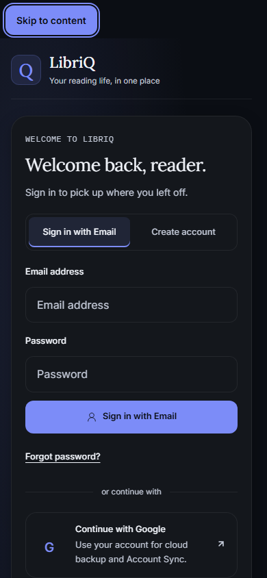

# Accessibility quick wins

Headless Chromium, 390 × 844, dark theme.

## Skip link

Hidden until it gets keyboard focus, then pinned top-left. It jumps to `#mainContent`.

## Not visual

- Each route sets `document.title` to `<page heading> · LibriQ`. The sign-in and boot screens stay `LibriQ`.
- After the first render, a route change moves focus to the page `h1`. Re-renders and same-route navigation leave focus alone.
- The mobile menu button reports `aria-expanded` and `aria-controls="sidebar"`.
- The theme toggle is named by its visible text ("Dark mode") with `aria-pressed`.
- The change-email field has an accessible name.
- Icon-font glyphs in `index.html` are `aria-hidden`.
