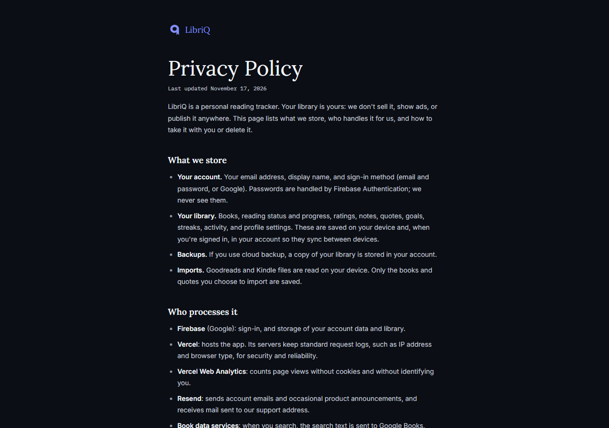
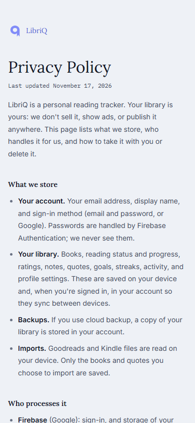
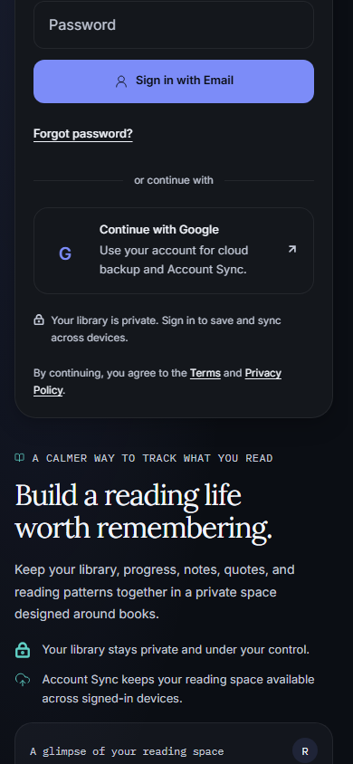

# Privacy and terms

Headless Chromium against the local dev server. No console errors and no horizontal overflow at 1280 or 390 px.

## Privacy policy, desktop, dark

## Privacy policy, mobile, light

The policy pages follow the system theme because they have no app shell.

## Sign-in screen

A consent line with underlined links sits under the privacy note.

