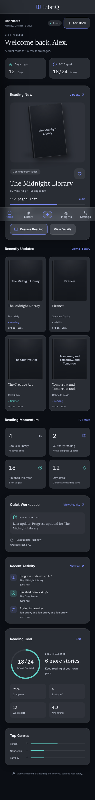
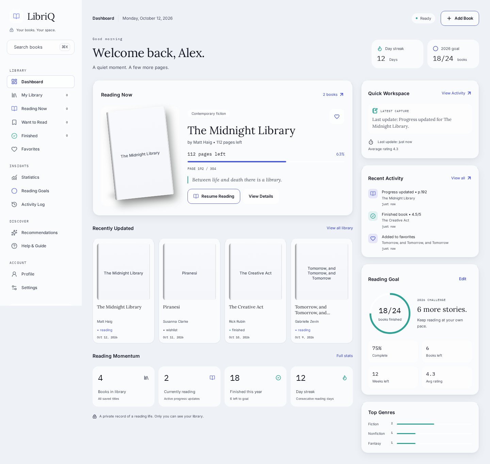
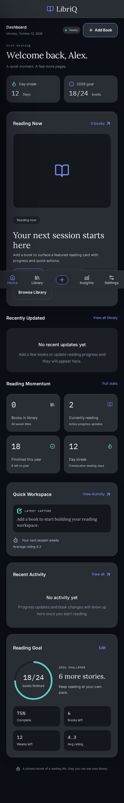
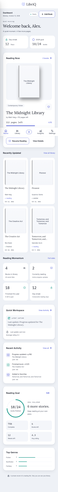

# Figma Dashboard implementation

Source: [Figma](https://www.figma.com/design/O9xTL78FlhlC6KSVeZv8O2/Figma?node-id=0-1), desktop `3:4202`, mobile `3:4651`, empty `3:5010`, and light/reduced-transparency specification `3:5038`.

## Coverage

| Surface | Status |
| --- | --- |
| Dashboard desktop | Applied: Reading Now, recent books, momentum, workspace, activity, goal, genres |
| Dashboard mobile | Applied: single column, compact header, fixed bottom navigation |
| Dashboard empty state | Applied |
| Dashboard light theme / opaque fallback | Applied |
| Shared tokens / sidebar / bottom navigation | Applied |
| PWA metadata / icons / local fonts | Applied |
| Library, Statistics, Goals, Activity, Quotes, Recommendations, Settings, Profile, Help | Not redesigned; inherited tokens only |
| Book Details modal, Kindle import, sign-in | Not redesigned |

Preserved action delegation, navigation hubs, badge IDs, authentication requirements, and the reduced-motion guard. Compatibility aliases keep deferred screens resolving existing token names. Restored the Statistics grid, chart, and shared goal structures without redesigning that page.

The screenshots use deterministic renderer fixtures with placeholder covers and sample library data, not an authenticated end-to-end session.

## Desktop / mobile

## Light / opaque / narrow

## Verification

- `npm test`: 38 tests passed.
- All `scripts/test-*-modules.mjs` passed.
- Dashboard, navigation, Statistics calculations/page, book identity/details, Goals, and Activity regressions passed.
- `npm run test:render` and `npm run build` passed.
- `npm run test:dashboard-design`: six responsive/theme states; no horizontal overflow, local fonts/assets, AA contrast assertions for Dashboard body/status text, and opaque zero-blur reduced-transparency surfaces.
- Both Statistics monthly charts retained a flex/percentage-height layout and desktop/mobile grid behavior.
- Dashboard calendar dates agree with the local day near midnight outside UTC.

The environment proposal caches incremental npm dependencies and Playwright Chromium. Existing npm audit findings were not changed by this UI work.
